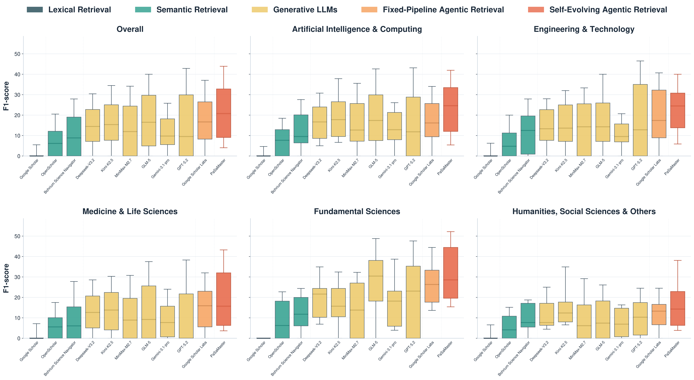
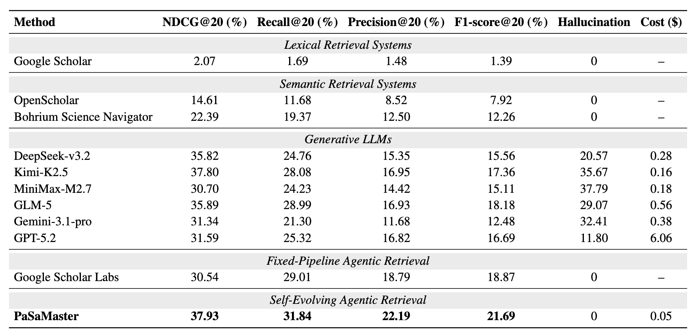

<div align="center">
  <h1>
    
    PaSaMaster
  </h1>

  <p><strong>Towards Self-Evolving Agentic Literature Retrieval</strong></p>

  <p>
    <a href="https://scimaster.bohrium.com/home">Website</a> |
    <a href="https://arxiv.org/pdf/2605.14306">arXiv Paper</a> |
    <a href="https://huggingface.co/datasets/PaSaMaster/PaSaMaster_bench">BenchMark</a> |
    <a href="https://www.npmjs.com/package/scimaster-cli?activeTab=readme">CLI / MCP Tool</a>
  </p>

  
</div>

## Overview

PaSaMaster is a self-evolving agentic literature retrieval system for high-quality scientific paper search and relevance ranking. It iteratively analyzes user intent, retrieves candidate papers, evaluates evidence, and produces relevance-scored recommendations grounded in real sources.

PaSaMaster is designed for both human researchers and AI agents that need reliable literature retrieval instead of shallow keyword matching or hallucinated references.

## Highlights

| Capability | What PaSaMaster Provides |
|------------|--------------------------|
| Agentic retrieval | Iterative query understanding, retrieval, and ranking for complex research intents. |
| Evidence-grounded results | Paper recommendations are tied to real retrieved sources, reducing citation hallucination. |
| High-quality ranking | Relevance-scored paper lists across broad scientific domains. |
| Agent-ready tooling | CLI and MCP server support through `scimaster-cli`, enabling direct integration into custom agents. |

## PaSaMaster CLI for Agentic Literature Retrieval

PaSaMaster can also be used from the command line through [`scimaster-cli`](https://www.npmjs.com/package/scimaster-cli?activeTab=readme), a SciMaster literature-search CLI powered by PaSaMaster. It provides both a `sci` command for direct terminal searches and a `sci-mcp` Model Context Protocol (MCP) server that can be plugged into your own agents, Claude Code, Cursor, or any MCP-compatible client.

This makes PaSaMaster available as a literature retrieval tool inside agent workflows. An agent can call `search_papers` with a research query and receive a structured, high-quality set of relevant papers, including metadata, abstracts, URLs, and BibTeX entries. This is useful for research assistants, review-writing agents, paper recommendation systems, and other literature-aware AI applications that need stronger recall and relevance ranking than simple keyword search.

### Quick Start

Install and run:

```bash
npm install -g scimaster-cli
sci init
sci search "CRISPR gene editing 2024" --limit 20 --mode low
```

Use it without installation:

```bash
npx -y scimaster-cli@latest search "machine learning protein" --limit 20
```

### MCP Integration

Register PaSaMaster as an MCP tool for your own agent:

```json
{
  "mcpServers": {
    "scimaster": {
      "command": "npx",
      "args": ["-y", "scimaster-cli"]
    }
  }
}
```

The MCP server exposes the following tool:

| Tool | Description |
|------|-------------|
| `search_papers` | Searches for relevant papers with `query`, `limit`, and `mode`, returning structured paper results for downstream agent reasoning. |

## Evaluation

Evaluated on the PaSaMaster Benchmark across 38 scientific disciplines, PaSaMaster substantially improves over traditional keyword retrieval and generative LLM baselines, achieving stronger relevance ranking, zero source hallucination, and competitive performance at a fraction of the computational cost.

<div align="center">
  
</div>

## Reproduction

<details>
<summary>Click to expand reproduction instructions</summary>

The research code includes the Navigator–Librarian retrieval pipeline, evaluation, and ranker training-data synthesis. Use Python 3.11 on Linux (or WSL) for the validated client environment, and run the commands below from the repository root. Ensure `python3.11 --version` works first; if Python 3.11 is provided by Conda or another environment manager, activate that environment before creating the venv. Model servers are configured separately; this client does not require a local GPU when all model endpoints are remote.

### 1. Install

```bash
git clone https://github.com/sjtu-sai-agents/PaSaMaster.git
cd PaSaMaster
python3.11 -m venv .venv
source .venv/bin/activate
pip install -r requirements.lock.txt
```

`requirements.lock.txt` records the validated client environment; `requirements.txt` is the unpinned direct-dependency list. On Debian/Ubuntu, install the venv package matching your Python 3.11 installation if creating the environment reports that `ensurepip` is unavailable.

If the machine cannot access PyPI, use an approved package mirror or download the locked dependencies on another Linux machine with Python 3.11, transfer the wheelhouse, and install with `pip install --no-index --find-links /path/to/wheelhouse -r requirements.lock.txt`. An index connectivity failure can appear as "No matching distribution found"; do not assume the pinned version is invalid without checking network access.

### 2. Configure services and data

Copy the configuration template, then fill in your model endpoints, API keys, and paths in the ignored local file:

```bash
cp config/config.json config/config.local.json
chmod 600 config/config.local.json
```

The pipeline automatically reads `config/config.local.json` when present. Alternatively, set `PASAMASTER_CONFIG` to a private configuration file outside the repository. Keep real keys out of the tracked templates. Four model roles are used by the main retrieval pipeline:

| Config name | Role |
|-------------|------|
| `deepseek-v3.2` | Navigator and query understanding |
| `qwen-30b-train` | Checklist scorer; the default template selects `qwen-flash` through its `model` field. For the paper configuration, deploy the [trained Ranker weights](https://huggingface.co/PaSaMaster/Ranker). |
| `reason_rank` | Global reranker |
| `qwen-flash` | Web summarization |

The config names are role selectors, not necessarily the model IDs accepted by your provider. Set `model` to an available served model ID in each entry (including `deepseek-v3.2` and `reason_rank` when needed). A model appearing in a provider list does not guarantee your account has access; run the setup probes before retrieval. These roles may share an endpoint for a workflow test. Navigator must support streaming chat and tool calls; the scorer and reranker must follow the repository's structured output prompts. Substitute models can be used to test the workflow, but reproducing the paper requires the original models. The reserved `qwen3-30b` entry, tokenizer paths, `common_config.meta_info_url`, and `metric_path` are not needed by the main retrieval command.

For a Qwen Flash workflow check, configure the same reachable OpenAI-compatible endpoint/key in `deepseek-v3.2`, `qwen-30b-train`, and `qwen-flash`, and set `"model": "qwen-flash"` in each entry. Keep `reason_rank` pointed at your configured reranker and set its `model` to the served ID if needed. The `deepseek-v3.2` name still selects the Navigator role; it does not force a DeepSeek model when `model` is provided. Do not use a substitute-model workflow score as a reproduction of the paper.


Configure Serper (`common_config.google_api_key`), Jina (`common_config.JINA_API_KEYS`), and Bohrium/SN (`sn_access_key` and `sn_*_url`) in that local file. SN keyword search, title metadata lookup, and reference lookup are separate endpoints and must all work. `config/web_agent.json` supplies search preferences; its placeholder keys are not used by the main pipeline. Set both proxy strings to `""` for direct access. Jina page fetching uses `common_config.proxy`; other HTTP clients use their own network/environment settings.

The default online configuration uses `qwen-flash` for checklist scoring and sets `use_local_search=false`, `use_reference_rag=false`, `use_chunk=false`, `use_local_cache=false`, and `use_reasoner=true`. It uses Serper and SN for retrieval and SN for reference lookup/expansion; it does not require a RAG server, a chunk server, or the local paper corpora. `meta_info_path` is empty by default, so metadata is obtained through the online SN service.

The optional retrieval features are independent:

| Setting | Purpose and requirements |
|---------|--------------------------|
| `use_local_search=true` | Direct semantic arXiv search via `common_config.arxiv_search_url`. |
| `use_reference_rag=true` | Add RAG-retrieved titles while filtering and expanding references. When false, SN expansion still runs. |
| `use_chunk=true` | Retrieve paper excerpts from `chunk_url` (`/paper_retrieve`). There is no automatic fallback to SN chunk search. |
| `use_local_cache=true` | Enable the five matching local corpus/index files listed below. |
| Nonempty `meta_info_path` | Load an optional paper metadata JSONL; leave empty for online metadata lookup. |

For the original research setup, use the trained Ranker, the original model deployments, `use_local_search=false`, `use_reference_rag=true`, `use_chunk=true`, `use_local_cache=true`, and a matching metadata JSONL. RAG and chunk backends and the corpus artifacts are not bundled here. A run with Qwen Flash and these optional services disabled validates the online workflow, not the paper's benchmark metrics.

Only the local-cache mode requires these five files:

```text
data/paper_database/id2paper.json
data/paper_database/cs_paper_2nd.zip
data/arxiv_dataset/arxiv_idx_aid2pos.json
data/arxiv_dataset/arxiv_idx_sim2pos.json
data/arxiv_dataset/arxiv-metadata-oai-snapshot.json
```

The indices must match the exact corpus snapshot and ZIP they index. If you already have that corpus, link it without copying:

```bash
mkdir -p data
ln -s /path/to/paper_database data/paper_database
ln -s /path/to/arxiv_dataset data/arxiv_dataset
```

For optional paper metadata, JSONL rows need a nonempty `title`; enrichment fields include `journal`, `paired_journal`, and `citedBy`.

The optional local file `config/journal_metainfo.jsonl` supplements missing h5, IF, and CCF fields in paper metadata. It is excluded from Git and is not required to start retrieval. If it is absent, the local supplement is skipped; metrics returned by the configured metadata service are still retained. Supply your own permitted journal metadata file if this enrichment is needed.

Download the [official PaSaMaster Benchmark](https://huggingface.co/datasets/PaSaMaster/PaSaMaster_bench) and use the complete dataset directly:

```bash
mkdir -p data
curl -fL https://huggingface.co/datasets/PaSaMaster/PaSaMaster_bench/resolve/main/benchmark.jsonl -o data/pasamaster_bench.jsonl
```

The pipeline, setup checker, and evaluator default to `data/pasamaster_bench.jsonl`. Samples with an empty `source_meta.published_time` use the run date as their retrieval cutoff. If the server cannot reach Hugging Face, download the file on another machine and copy it into `data/`.

### 3. Run and evaluate

Start with one official benchmark query to verify installation, services, retrieval, scoring, and evaluation before launching all 244 tasks:

```bash
python check_setup.py --check-models --check-services
head -n 1 data/pasamaster_bench.jsonl > data/smoke.jsonl
python PasaMaster.py --data_path data/smoke.jsonl --max_workers 5 --use_reasoner True --max_rounds 3 --continue_path result/readme_smoke
python metrics.py --input_folder result/readme_smoke
```

The smoke command resumes an existing `result/readme_smoke` directory and skips completed queries. To perform a fresh check, use a new output directory. Inspect `0.json`, the run log, and `eval_result.json`; a zero exit code alone does not establish that retrieval or scoring succeeded.

For the full benchmark:

```bash
python PasaMaster.py --max_workers 5 --use_reasoner True --max_rounds 3
# Replace <timestamp> with the directory created by the run.
python metrics.py --input_folder "result/pasamaster_bench_<timestamp>"
```

The setup checker validates dependencies, input format, required configuration, and the services enabled by the selected mode. It probes the four model roles, Serper, Jina, all three SN endpoints, and RAG/chunk only when enabled. Resolve failures before retrieval. These small probes do not verify model tool-call behavior or benchmark quality; check the actual run log for HTTP errors, model failures, and empty/scoring-failed results.

With `--use_reasoner True`, the Navigator proposes search directions and a checklist; Librarian retrieves and scores papers, then feeds ranked evidence back to the Navigator for the next round. `--max_rounds` sets the upper limit (default 3). The loop stops earlier when the Navigator is satisfied, or when neither papers nor new search directions are available. Each result records `cooperation_rounds` and `stop_reason`; per-query snapshots are saved under the result directory's `shared_mind_logs/` folder.

Query results are saved as `result/pasamaster_bench_<timestamp>/{idx}.json`; evaluation writes `eval_result.json` in the same directory. Add `--continue_path result/pasamaster_bench_<timestamp>` to resume retrieval. The evaluation script defaults to a `2025-11-01` cutoff; use `--end_date YYYY-MM-DD` to change it or `--end_date ""` to disable that filter.

Workflow checks with substitute models and optional retrieval features disabled do not validate the complete research configuration or the paper's benchmark metrics. Upstream metadata can contain incorrect dates, and reference expansion can leave papers beyond the requested cutoff in the raw results; strict cutoff compliance has not been validated. Evaluation applies its separate `--end_date` filter. Final scores include a relative reranking transformation and are not relevance probabilities. Check hard constraints independently when assessing quality.

Optional ranker training-data synthesis scripts are available in [`create_dataset/`](create_dataset/). Default paths are anchored to this repository: generated datasets go under `result/dataset_final` or `result/dataset_refcluster`, and scoring prompts come from `prompt/papermaster_prompt.json`. The standalone reasoner demo writes logs and traces under `result/reasoner_demo`; these outputs are excluded from Git. They require their own input data, paths, and model entries; they are not part of the validated retrieval setup or a complete training reproduction recipe.

</details>

## Citation

If you find PaSaMaster useful, please cite:

```bibtex
@article{du2026towards,
  title={Towards Self-Evolving Agentic Literature Retrieval},
  author={Du, Yuwen and Jin, Tian and Kang, Jing and Pang, Xianghe and Chai, Jingyi and Miao, Tingjia and Liu, Fenyi and Wang, WenHao and Yao, Sikai and Zhang, Yuzhi and others},
  journal={arXiv preprint arXiv:2605.14306},
  year={2026}
}
```
